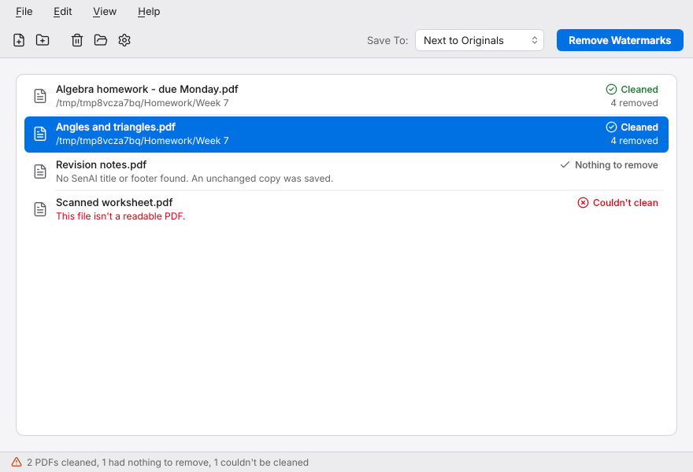
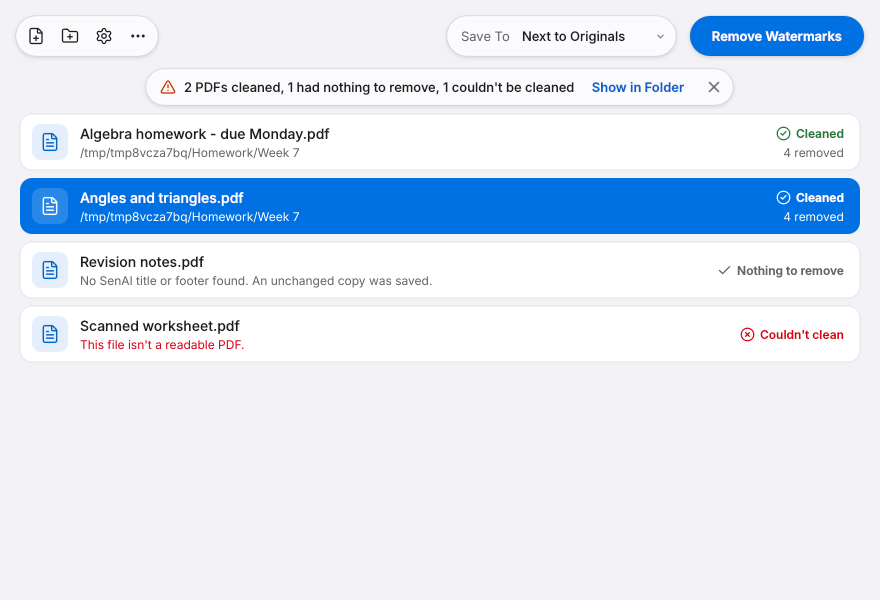
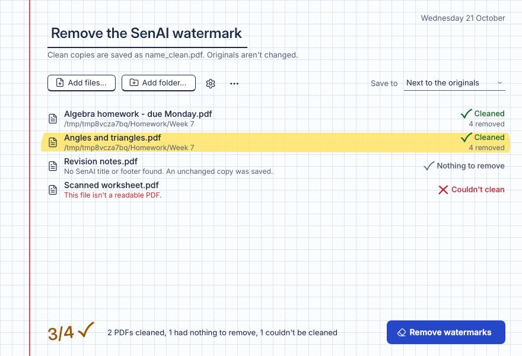
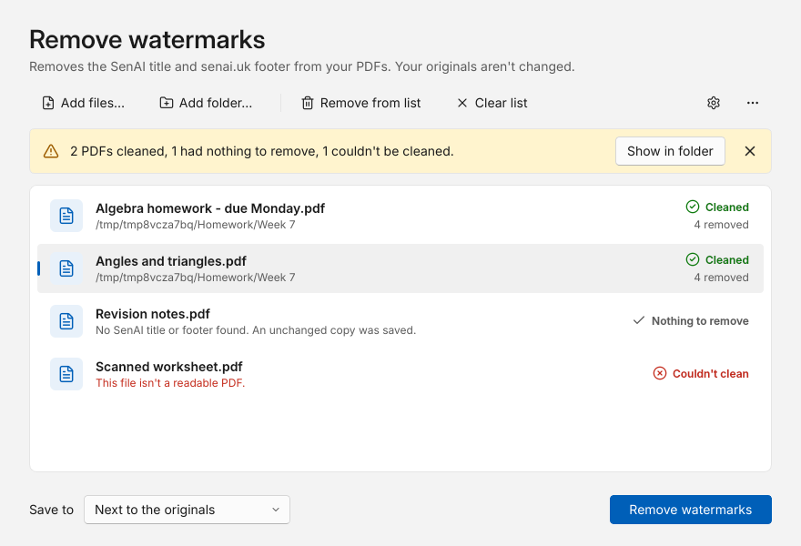
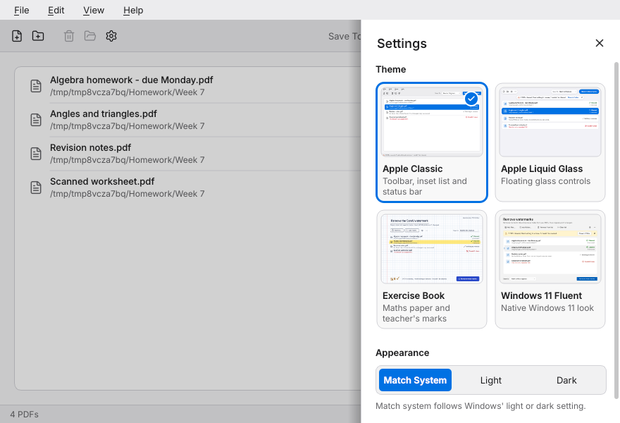
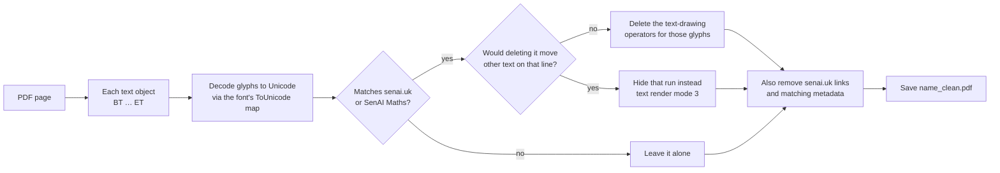

<p align="center">
  
</p>

<h1 align="center">SenAI Watermark Remover</h1>

<p align="center">
  <strong>Clean copies of your SenAI Maths PDFs, without the “SenAI Maths” title or the senai.uk footer.</strong><br>
  Drop your PDFs in, press one button, and get clean copies. Everything else stays exactly as it was.
</p>

<p align="center">
  <a href="https://github.com/ImBrinn/Senai-watermark-remover/releases/latest"></a>
  
  
  
</p>

<p align="center">
  <a href="https://github.com/ImBrinn/Senai-watermark-remover/releases/latest/download/SenAI-Watermark-Remover.exe"><strong>⬇&nbsp;Download for Windows</strong></a>
  &nbsp;·&nbsp;
  <a href="https://github.com/ImBrinn/Senai-watermark-remover/releases">All releases</a>
  &nbsp;·&nbsp;
  <a href="CHANGELOG.md">What’s new</a>
</p>

<p align="center">
  <picture>
    <source media="(prefers-color-scheme: dark)" srcset="docs/screenshots/apple-classic-dark.png">
    
  </picture>
</p>

---

## Contents

- [Highlights](#highlights)
- [Download](#download)
- [How to use it](#how-to-use-it)
- [Themes](#themes)
- [Settings](#settings)
- [Keyboard shortcuts](#keyboard-shortcuts)
- [What gets removed](#what-gets-removed)
- [Troubleshooting](#troubleshooting)
- [Command line](#command-line)
- [How it works](#how-it-works)
- [Accessibility](#accessibility)
- [Building from source](#building-from-source)
- [Credits and licences](#credits-and-licences)

## Highlights

- **Removes only the branding.** The “SenAI Maths” title and the senai.uk footer are deleted from the PDF itself, not hidden under a white box. Answers, working, diagrams and page numbers are untouched.
- **Never touches your originals.** Cleaned copies are saved as `name_clean.pdf`, next to the originals or in a folder you choose.
- **Drag and drop.** Drop single PDFs or a whole folder onto the window.
- **Clear results.** Every file gets its own result and, when something goes wrong, a plain-language reason.
- **Four themes.** Apple Classic, Apple Liquid Glass, Exercise Book and Windows 11 Fluent, each in light and dark.
- **Private.** Everything runs on your computer. Your files are never uploaded anywhere.
- **No install.** One `.exe`, about 38 MB.

## Download

1. Download **[SenAI-Watermark-Remover.exe](https://github.com/ImBrinn/Senai-watermark-remover/releases/latest/download/SenAI-Watermark-Remover.exe)** from the [latest release](https://github.com/ImBrinn/Senai-watermark-remover/releases/latest).
2. Double-click it. There’s nothing to install.
3. If Windows SmartScreen says it protected your PC, choose **More info → Run anyway**. It shows that warning because the app isn’t code-signed.

Older versions are on the [releases page](https://github.com/ImBrinn/Senai-watermark-remover/releases), and the [changelog](CHANGELOG.md) lists what changed in each.

## How to use it

| | |
|---|---|
| **1. Add your PDFs** | Drag PDFs or a whole folder onto the window, or use **Add Files…** / **Add Folder…**. |
| **2. Remove the watermarks** | Click **Remove Watermarks** or press <kbd>Ctrl</kbd>+<kbd>Enter</kbd>. |
| **3. Check each file** | Each row shows its result: **Cleaned · 9 removed**, **Nothing to remove**, or **Couldn’t clean** with the reason. |
| **4. Open the results** | **Show in Folder** opens where the cleaned copies were saved. |

Cleaned copies are named `name_clean.pdf`. If two files with the same name go to one folder, the second becomes `name_clean (2).pdf`, then ` (3)`, and so on, so nothing is overwritten.

## Themes

Pick a theme in **Settings**, or switch instantly with <kbd>Ctrl</kbd>+<kbd>1</kbd> to <kbd>Ctrl</kbd>+<kbd>4</kbd>. Your file list and results carry over. Every theme comes in light and dark. The screenshots below follow your GitHub appearance.

<table>
  <tr>
    <td width="50%" valign="top">
      <picture>
        <source media="(prefers-color-scheme: dark)" srcset="docs/screenshots/apple-classic-dark.png">
        
      </picture>
      <p><strong>1 · Apple Classic</strong><br>
      A Mac-style window that follows Apple’s Human Interface Guidelines: a menu bar with every command, a symbol toolbar with one prominent action, an inset list and a status bar.</p>
    </td>
    <td width="50%" valign="top">
      <picture>
        <source media="(prefers-color-scheme: dark)" srcset="docs/screenshots/apple-glass-dark.png">
        
      </picture>
      <p><strong>2 · Apple Liquid Glass</strong><br>
      Apple’s current design language: floating glass toolbar capsules over files that blur as they scroll underneath, with a solid fallback when Windows transparency effects are off.</p>
    </td>
  </tr>
  <tr>
    <td width="50%" valign="top">
      <picture>
        <source media="(prefers-color-scheme: dark)" srcset="docs/screenshots/exercise-book-dark.png">
        
      </picture>
      <p><strong>3 · Exercise Book</strong><br>
      Squared maths paper with a red margin, highlighter selection, hand-drawn ticks and a teacher’s score like “3/4”. In dark mode it becomes a chalkboard.</p>
    </td>
    <td width="50%" valign="top">
      <picture>
        <source media="(prefers-color-scheme: dark)" srcset="docs/screenshots/fluent-dark.png">
        
      </picture>
      <p><strong>4 · Windows 11 Fluent</strong><br>
      A native Windows 11 look: a command bar, cards, InfoBar messages and Segoe UI.</p>
    </td>
  </tr>
</table>

## Settings

Open Settings with the gear button in any theme, from the menus, or with <kbd>Ctrl</kbd>+<kbd>,</kbd>. A panel slides in from the right with:

- **Theme**: the four themes as preview cards. Click one to switch instantly.
- **Appearance**: **Match system**, **Light** or **Dark**.

Your choices are saved and restored next time, in `%APPDATA%\SenAI\Watermark Remover.ini`.

<p align="center">
  <picture>
    <source media="(prefers-color-scheme: dark)" srcset="docs/screenshots/settings-dark.png">
    
  </picture>
</p>

## Keyboard shortcuts

| Shortcut | Action |
|---|---|
| <kbd>Ctrl</kbd>+<kbd>O</kbd> | Add files |
| <kbd>Ctrl</kbd>+<kbd>Shift</kbd>+<kbd>O</kbd> | Add a folder |
| <kbd>Ctrl</kbd>+<kbd>Enter</kbd> | Remove watermarks |
| <kbd>Delete</kbd> | Remove the selected files from the list |
| <kbd>Ctrl</kbd>+<kbd>,</kbd> | Open Settings |
| <kbd>Ctrl</kbd>+<kbd>1</kbd> … <kbd>Ctrl</kbd>+<kbd>4</kbd> | Switch theme |
| <kbd>Ctrl</kbd>+<kbd>Q</kbd> | Exit |

In **Apple Liquid Glass**, tap <kbd>Alt</kbd> to show the menu bar.

## What gets removed

| Removed | Kept exactly as it was |
|---|---|
| The **“SenAI Maths”** title on page 1 | Questions, answers and working |
| The **senai.uk** footer on every page | Diagrams and images |
| Links pointing to senai.uk | Page numbers |
| Document metadata that mentions SenAI | Your original file, which is never changed |

## Troubleshooting

<details>
<summary><strong>Windows SmartScreen won’t let me open the app</strong></summary>

<br>

The app isn’t code-signed, so SmartScreen warns the first time. Choose **More info → Run anyway**.
</details>

<details>
<summary><strong>“Couldn’t save name_clean.pdf. If it’s open in a PDF viewer, close it and try again.”</strong></summary>

<br>

A cleaned copy from an earlier run is still open in a PDF viewer, and Windows won’t let it be replaced. Close it and press **Remove Watermarks** again.
</details>

<details>
<summary><strong>“Nothing to remove”</strong></summary>

<br>

No SenAI title or footer was found in that file. It may already be clean, or it may not come from SenAI. An unchanged copy is still saved, so you always get a `_clean.pdf`.
</details>

<details>
<summary><strong>“This PDF is password protected, so it can’t be cleaned.”</strong></summary>

<br>

Password-protected PDFs can’t be opened for cleaning.
</details>

<details>
<summary><strong>“This file isn’t a readable PDF.”</strong></summary>

<br>

The file is damaged, incomplete, or not actually a PDF. Try downloading it again.
</details>

<details>
<summary><strong>Are my files uploaded anywhere?</strong></summary>

<br>

No. Everything happens on your computer, and nothing is sent over the internet.
</details>

## Command line

The command line needs only Python 3.9+ and [pypdf](https://pypi.org/project/pypdf/), not Qt:

```bash
pip install .

senai-remover homework.pdf                 # -> homework_clean.pdf
senai-remover ~/Downloads/senai            # every PDF in a folder
senai-remover *.pdf -o cleaned/            # into another folder, keeping the same names
senai-remover homework.pdf --in-place      # overwrite the original
senai-remover homework.pdf --suffix _nobrand
senai-remover --version
```

If SenAI ever adds other branding, `--pattern` removes extra text. It takes a case-insensitive regular expression and can be repeated:

```bash
senai-remover homework.pdf --pattern "made with senai"
```

To run the app itself from source:

```bash
pip install ".[gui]"
senai-remover-gui                          # or: python -m senai_remover
```

`python -m senai_remover` with no arguments, or with `--design N`, opens the app. With any other arguments it behaves like `senai-remover`.

## How it works

SenAI PDFs are made by headless Chrome (Skia), and the branding is ordinary text, so it can be removed exactly:



Only the text-drawing operators (`Tj`, `TJ`, `'` and `"`) that draw the branding are removed. Every other operator on the page is kept.

## Accessibility

- Every theme follows Windows’ light or dark mode, or the Appearance you choose in Settings.
- Every text colour pair each theme declares is tested at **4.5:1 contrast or better**, in light, dark and high contrast.
- The themes respect Windows’ high-contrast, transparency and animation settings.
- Everything works from the keyboard, focus is always visible, and icon-only buttons have names for screen readers.

## Building from source

<details>
<summary><strong>Development setup, tests and tools</strong></summary>

<br>

```bash
pip install -e ".[gui,test]"
QT_QPA_PLATFORM=offscreen pytest           # no display needed
python tools/screenshots.py shots/         # renders every theme, light and dark
python tools/make_icon.py                  # redraws the app icon (needs Pillow)
```

The tests cover the PDF cleaner, the command line and the app’s file model. They also drive every theme offscreen, covering:

- adding files and drag and drop
- cleaning and keyboard shortcuts
- switching themes
- contrast checks

`tests/fixtures/senai_sample.pdf` is a stand-in for a real SenAI export. `tests/fixtures/make_sample.cjs` makes it with the same Chrome/Skia pipeline (it needs Node and Playwright).
</details>

<details>
<summary><strong>Building the Windows .exe</strong></summary>

<br>

```bash
pip install ".[gui]" pyinstaller
pyinstaller --onefile --windowed --name SenAI-Watermark-Remover \
  --icon senai_remover/gui/assets/app.ico \
  --add-data "senai_remover/gui/assets:senai_remover/gui/assets" \
  --paths . senai_remover/__main__.py
```

The app ends up in `dist/SenAI-Watermark-Remover.exe`.
</details>

<details>
<summary><strong>Working on it with Claude Code</strong></summary>

<br>

The repository is set up as a Claude Code project:

- [`CLAUDE.md`](CLAUDE.md) describes the architecture, commands, theme rules, release steps and known issues, so every session starts with full context.
- A SessionStart hook ([`.claude/hooks/session-start.sh`](.claude/hooks/session-start.sh)) installs the dependencies and Qt's libraries in cloud sessions, so tests run straight away.
- Project skills (slash commands):
  - `/build-exe` builds and smoke-tests the Windows app under Wine.
  - `/release` cuts a version.
  - `/screenshots` regenerates the images.
  - `apple-design` reviews UI against Apple's Human Interface Guidelines.
</details>

<details>
<summary><strong>Project layout</strong></summary>

<br>

```text
senai_remover/
├── core.py              PDF cleaning
├── cli.py               command line
└── gui/
    ├── app.py           start-up and theme switching
    ├── controller.py    file list model and background cleaning
    ├── model.py         file statuses, output names, messages (no Qt)
    ├── settings.py      saved theme and appearance
    ├── settings_panel.py
    ├── theme.py         fonts, icons, colour maths, system settings
    ├── widgets.py       shared widgets
    ├── designs/         base.py plus one file per theme
    └── assets/          fonts, icons, theme previews, app icon
tests/                   pytest suite and the sample PDF
tools/                   screenshots and icon generator
docs/screenshots/        README images
.github/workflows/       ci.yml and release.yml
CLAUDE.md, .claude/      Claude Code project: context, settings, hook, skills
```
</details>

## Credits and licences

- [Qt 6.8](https://www.qt.io/) via [PySide6](https://pypi.org/project/PySide6-Essentials/) (LGPL)
- [Inter](https://rsms.me/inter/) typeface (SIL Open Font License)
- [Lucide](https://lucide.dev/) icons (ISC licence)
- [pypdf](https://pypi.org/project/pypdf/) (BSD)

The licence texts for Inter and Lucide are included in [`senai_remover/gui/assets/`](senai_remover/gui/assets/).
